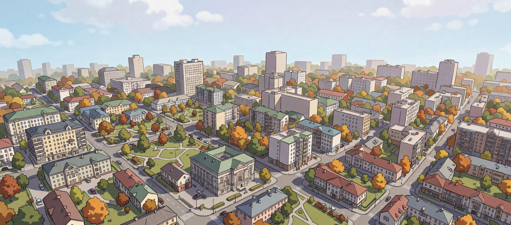
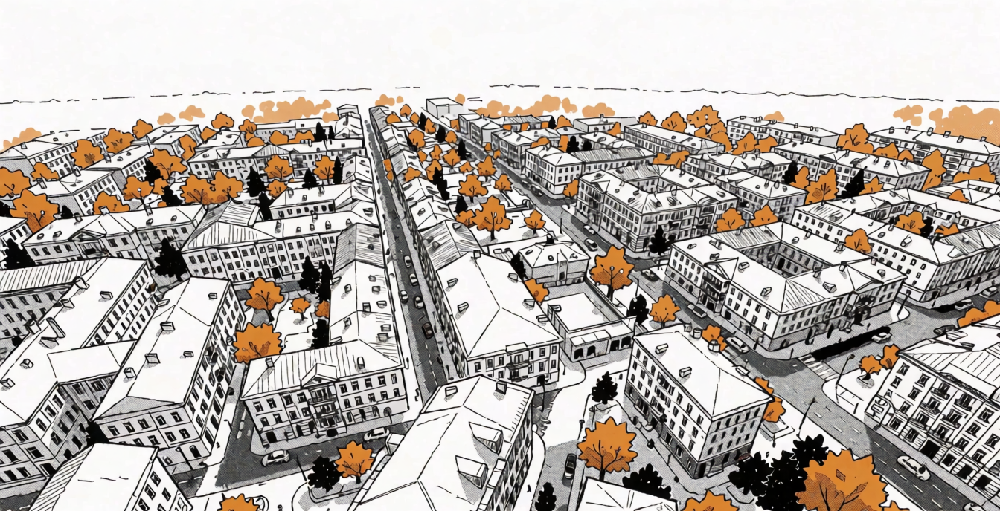

# World360

Any place on Earth as a comic background. Type a city or address: World360 builds the streets in 3D from OpenStreetMap and draws them like a manga page, with ink lines, screentone and solid blacks. Fly over the city or walk it at eye level, then export a PNG or GLB, or send the frame to an image model that repaints it as a manga or webtoon panel.

Live demo: https://world360.ihatebot.com

| Webtoon | Manga |
|---|---|
|  |  |

<sub>Comic renders made from World360 frames with Krea2.</sub>

Inspired by [どこでもロケハン](https://oyasumi-gamedev.com/tools/rokehan/).

## Features

- **Search**: place name, address, `lat, lon`, degrees/minutes/seconds, Google Maps and OpenStreetMap links, or drop a KML/GeoJSON file. Shift+click the scene to move the pin.
- **City**: buildings, roads, footpaths, rails, water, parks and trees within 200 m – 1 km. Heights come from OSM tags; when a building has none, the height is guessed from its type and footprint (🎲 re-rolls the guesses). Small rectangular houses get gabled or hipped roofs. Four seasons, optional people and cars.
- **Camera**: presets (bird's-eye, top-down, intersection, street, low angle), 14–85 mm lens, two-point perspective, walk mode (WASD + mouse look, Shift to run), double-click to fly to a point.
- **Drawing**: color, color + lines, lines, lines + tone, and Manga+ (lines + tone plus facade windows, rooftop units, utility poles with wires and an inked sky, all procedural). Line width, edge detail, tone pattern (dots / lines / cross-hatch), tone size and threshold, solid black fill, white-out. Manual or real sun position with shadows.
- **Export**: PNG up to 4800 px (transparent background, OSM credit), GLB with the whole scene, and a share link that keeps place, camera and style.
- **Comic render** (optional): the current frame is used as an img2img base for Krea2 on your own ComfyUI.
- **Interface**: English and Ukrainian.

## How it works

- **Map data.** OpenFreeMap vector tiles (OpenMapTiles schema, z14) load first, from a CDN, in about a second. Overpass is queried in the background for full OSM detail (building types, single trees). When it answers, the city is rebuilt inside the radius, and the tile data beyond the radius stays as the far zone. Everything is cached in the browser for 7 days.
- **Rendering.** Two passes in three.js. A lit color pass with shadows, then a G-buffer pass that writes view-space normals, an object id and depth. A full-screen shader draws lines wherever the id, the normal or the depth jumps. It turns luminance into screentone.
- **Comic render.** The browser renders the frame in color + lines; manga gets it in greyscale. The frame goes to `world360-api` with a prompt. The prompt has a sentence about the camera (height, tilt, lens, direction), the city name from reverse geocoding and the season. The server runs Krea2 turbo img2img on ComfyUI and returns the result. A plain white line-art frame does not work as a base: the model fills empty areas with whatever the prompt suggests.

## Run it

Frontend only (everything except comic render):

```bash
npm install
npm run dev        # http://localhost:5173
npm run build      # static site in dist/
```

With comic render you also need ComfyUI (0.37+) with these models:

| file | folder |
|---|---|
| `krea2_turbo_fp8_scaled.safetensors` | `models/diffusion_models` |
| `qwen3vl_4b_fp8_scaled.safetensors` | `models/text_encoders` |
| `qwen_image_vae.safetensors` | `models/vae` |

Then start the API (Go 1.27+). In dev, Vite proxies `/api` to it:

```bash
cd server
go run . -comfy http://127.0.0.1:8188
```

Flags: `-listen` (default `127.0.0.1:18096`), `-comfy`, `-unet`, `-clip`, `-vae`, `-per-day` (generations per client IP per 24 h, default 2), `-unlimited` (comma-separated IPs without the limit; private ranges are always unlimited), `-max-queue`, `-quota-file`.

The API trusts the first `X-Forwarded-For` hop. Keep it on loopback behind a reverse proxy that sets that header. `deploy/` has an example Caddyfile and systemd unit.

## Data and credits

Map data © [OpenStreetMap contributors](https://www.openstreetmap.org/copyright) (ODbL). Credit it when you publish images made with World360; the PNG export can add the line for you. Tiles: [OpenFreeMap](https://openfreemap.org). Search: Nominatim, Overpass API.

## License

MIT
